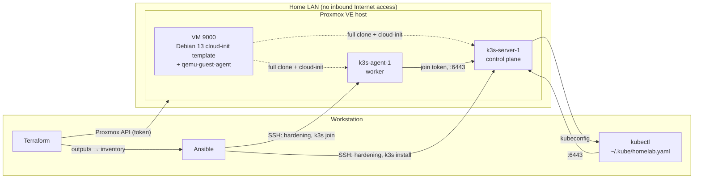

# homelab-platform

A self-hosted DevSecOps platform, fully described as code.

## Goal

Build from scratch a platform that deploys an application in an **automated**, **secure** and **observable** way. Everything is code: the whole platform can be destroyed and rebuilt with a single command.

This repository holds the **infrastructure and deployments**. The application it runs, [VulnWatch](https://github.com/<your-account>/vulnwatch), lives in its own repository: a vulnerability monitoring service that analyzes project SBOMs and flags components affected by CVEs.

## Stack

- **Hypervisor**: Proxmox VE on a physical server
- **Provisioning**: Terraform (Proxmox VMs, Cloudflare DNS)
- **Configuration**: Ansible (hardening, k3s installation)
- **Orchestration**: k3s
- **Delivery**: GitOps with ArgoCD, Helm and Kustomize
- **Observability**: Prometheus, Grafana, Loki, Alertmanager
- **Security**: SOPS, Kyverno, Trivy, cert-manager, IaC scanning in CI
- **Exposure**: Cloudflare Tunnel, no open ports

## Current architecture (M1)



- One physical **Proxmox VE** host.
- A Debian 13 **cloud-init template** (VM 9000), with the QEMU guest agent baked in. See [the runbook](docs/runbooks/template-cloud-init.md).
- **Terraform** clones the template into two VMs: `k3s-server-1` (control plane) and `k3s-agent-1` (worker).
- **Ansible** hardens the VMs, installs a pinned **k3s** version, joins the agent to the server and copies the kubeconfig to the workstation.
- The Ansible inventory is **generated from Terraform outputs**, so the VM list lives in one place.
- Nothing is exposed to the Internet: Proxmox and the cluster are reachable from the LAN only.

## Rebuild the cluster

### Prerequisites

- A Proxmox VE host with the cloud-init template built. Build it with [`scripts/build-template.sh`](scripts/build-template.sh), run on the node:

  ```bash
  ssh root@<proxmox-host> 'bash -s' < scripts/build-template.sh
  ```

  The [runbook](docs/runbooks/template-cloud-init.md) explains each step.
- A Proxmox user `terraform@pve` with a restricted role and an API token.
- On the workstation: Terraform, Ansible, `kubectl`, and an SSH key loaded in `ssh-agent`.
- `terraform/terraform.tfvars`, created from [`terraform.tfvars.example`](terraform/terraform.tfvars.example).
- `terraform/.env` with the Proxmox credentials, created from [`terraform/.env.example`](terraform/.env.example). Both files are git-ignored:

  ```bash
  cp terraform/.env.example terraform/.env && chmod 600 terraform/.env
  ```

### Steps

From the repository root:

```bash
make rebuild
```

It runs, in order, and stops at the first error:

1. `terraform init` and `terraform apply` (shows the plan and asks for `yes`; `make rebuild AUTO_APPROVE=1` skips the prompt), with the credentials from `terraform/.env` loaded for Terraform only.
2. `make inventory`: generates `ansible/inventory/hosts.yml` from Terraform outputs.
3. `make known-hosts-reset`: forgets the SSH host keys of the recreated VMs.
4. `make ansible`: waits for the VMs to accept SSH, hardens them, installs k3s and writes the kubeconfig to `~/.kube/homelab.yaml`.
5. `kubectl wait`: fails unless every node is `Ready` within 3 minutes, then lists the nodes.

To tear everything down: `make destroy` (always asks for confirmation). A full rebuild test is `make destroy && make rebuild`.

Each step is also a target of its own; run `make help` to list them all.

## Documentation

- [Architecture decision records](docs/adr/)
- [Runbooks](docs/runbooks/)

## Roadmap

| Milestone | Scope | Status |
| --- | --- | --- |
| M1 — Foundation | Proxmox, VMs with Terraform, k3s with Ansible | In progress |
| M2 — Local app | VulnWatch MVP | To do |
| M3 — Supply chain | Image scanning, SBOM, signing | To do |
| M4 — GitOps | Staging and production deployments with ArgoCD | To do |
| M5 — Observability | Metrics, logs, alerting | To do |
| M6 — Platform security | Policies, encrypted secrets, TLS | To do |
| M7 — Reliability | Tested backups, runbooks, postmortems | To do |

## Repository layout

```
terraform/      Proxmox VMs, Cloudflare DNS
ansible/        VM hardening, k3s installation
platform/       ArgoCD, monitoring, security, databases
apps/           application deployments (staging, production)
docs/
├── adr/        architecture decision records
├── runbooks/   operational procedures
└── postmortems/ real incidents and lessons learned
```