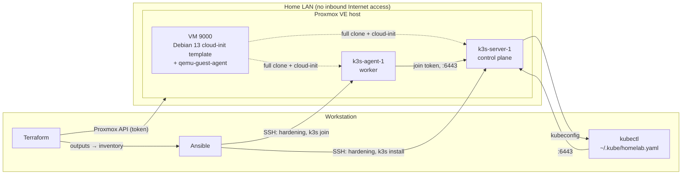

# homelab-platform

A self-hosted DevSecOps platform, fully described as code.

## Goal

Build from scratch a platform that deploys an application in an **automated**, **secure** and **observable** way. Everything is code: the whole platform can be destroyed and rebuilt with a single command.

This repository holds the **infrastructure and deployments**. The application it runs, **Shortlink**, lives in its own repository: a small Spring Boot URL shortener (PostgreSQL, Flyway, Actuator). It is deliberately simple, so the effort goes into building, shipping, watching and securing it.

## Stack

- **Hypervisor**: Proxmox VE on a physical server
- **Provisioning**: Terraform (Proxmox VMs, Cloudflare DNS)
- **Configuration**: Ansible (hardening, k3s installation)
- **Orchestration**: k3s
- **Delivery**: GitOps with ArgoCD, Helm and Kustomize
- **Observability**: VictoriaMetrics, vmalert, Alertmanager, Grafana
- **Security**: SOPS, Kyverno, Trivy, cosign, CycloneDX SBOMs, IaC scanning in CI
- **Exposure**: Cloudflare Tunnel, no open ports

## Resource budget

The whole lab runs on one laptop with **8 GB of RAM**. After Proxmox, k3s and the VM operating systems, about 4 to 5 GB are left for workloads. This drives the tool choices:

- **Run in CI, not in the cluster.** Image builds, SBOM generation, Trivy scans and cosign signing run on GitHub Actions and cost no cluster memory.
- **Pick the light option.** VictoriaMetrics instead of the full kube-prometheus-stack, a trimmed ArgoCD (no Dex, notifications or ApplicationSet), a single Kyverno admission controller.
- **Defer the heavy tools.** Dependency-Track (about 5 GB) and Loki are planned as extensions once the host gets more RAM. Until then, a nightly CI job rescans the SBOMs of deployed images for new CVEs.
- **Swap is a safety net, not capacity.** KSM on the host and zram in the VMs reclaim some memory; JVM workloads must never rely on swap.

The core platform is expected to fit in about 2.5 GB.

## Current architecture (M1)



- One physical **Proxmox VE** host.
- A Debian 13 **cloud-init template** (VM 9000), with the QEMU guest agent baked in. See [the runbook](docs/runbooks/template-cloud-init.md).
- **Terraform** clones the template into two VMs: `k3s-server-1` (control plane) and `k3s-agent-1` (worker).
- **Ansible** hardens the VMs, installs a pinned **k3s** version, joins the agent to the server and copies the kubeconfig to the workstation.
- The Ansible inventory is **generated from Terraform outputs**, so the VM list lives in one place.
- Nothing is exposed to the Internet: Proxmox and the cluster are reachable from the LAN only.

## Rebuild the cluster

### Prerequisites

- A Proxmox VE host with the cloud-init template built. Build it with [`scripts/build-template.sh`](scripts/build-template.sh), run on the node:

  ```bash
  ssh root@<proxmox-host> 'bash -s' < scripts/build-template.sh
  ```

  The [runbook](docs/runbooks/template-cloud-init.md) explains each step.
- A Proxmox user `terraform@pve` with a restricted role and an API token.
- On the workstation: Terraform, Ansible, `kubectl`, `sops`, `age`, and an SSH key loaded in `ssh-agent`.
- An age key in `~/.config/sops/age/keys.txt`, used to encrypt and decrypt the secrets committed in this repository. See [the SOPS runbook](docs/runbooks/sops-age.md).
- `terraform/terraform.tfvars`, created from [`terraform.tfvars.example`](terraform/terraform.tfvars.example).
- `terraform/.env` with the Proxmox credentials, created from [`terraform/.env.example`](terraform/.env.example). Both files are git-ignored:

  ```bash
  cp terraform/.env.example terraform/.env && chmod 600 terraform/.env
  ```

### Steps

From the repository root:

```bash
make rebuild
```

It runs, in order, and stops at the first error:

1. `terraform init` and `terraform apply` (shows the plan and asks for `yes`; `make rebuild AUTO_APPROVE=1` skips the prompt), with the credentials from `terraform/.env` loaded for Terraform only.
2. `make inventory`: generates `ansible/inventory/hosts.yml` from Terraform outputs.
3. `make known-hosts-reset`: forgets the SSH host keys of the recreated VMs.
4. `make ansible`: waits for the VMs to accept SSH, hardens them, installs k3s and writes the kubeconfig to `~/.kube/homelab.yaml`.
5. `kubectl wait`: fails unless every node is `Ready` within 3 minutes, then lists the nodes.
6. `make bootstrap`: loads the age key into the cluster, installs ArgoCD and creates the root application. From then on, ArgoCD deploys everything under [`platform/apps/`](platform/apps/) from the `main` branch.

Open the ArgoCD UI with `make argocd-ui` (prints the admin password, then serves it on https://localhost:8080).

To tear everything down: `make destroy` (always asks for confirmation). A full rebuild test is `make destroy && make rebuild`.

Each step is also a target of its own; run `make help` to list them all.

## Documentation

- [Architecture decision records](docs/adr/): why each main option was chosen.
- [Runbooks](docs/runbooks/): how to run each operational task.
- [Build journal](docs/journal/): how each milestone was built, step by step, with the problems met and how they were fixed. Start with [M1 — Foundation](docs/journal/m1-foundation/).

## Roadmap

The platform is built first, so the application lands on a complete delivery chain.

| Milestone | Scope | Status |
| --- | --- | --- |
| [M1 — Foundation](docs/journal/m1-foundation/) | Proxmox, VMs with Terraform, k3s with Ansible | Done |
| M2 — GitOps | ArgoCD (app of apps) bootstrapped by `make rebuild`, secrets encrypted with SOPS and age | To do |
| M3 — Observability | VictoriaMetrics, vmalert, Alertmanager, Grafana, cluster dashboards and alerts | To do |
| M4 — Application and supply chain | Shortlink MVP; CI with CycloneDX SBOM, Trivy, cosign and GHCR; staging and production overlays; nightly SBOM rescan | To do |
| M5 — Platform security | Kyverno (signed images only, pod security), Cloudflare Tunnel and DNS with Terraform | To do |
| M6 — Reliability | Tested PostgreSQL backups and restore, runbooks, postmortems | To do |

### Extensions (after a RAM upgrade)

| Extension | Replaces in the meantime |
| --- | --- |
| Dependency-Track, fed by the CI SBOMs | Nightly SBOM rescan in CI |
| Loki for logs | `kubectl logs` |
| cert-manager for in-cluster TLS | TLS terminated by Cloudflare |
| Always-on staging | Staging scaled to zero outside validation runs |

## Repository layout

```
terraform/      Proxmox VMs, Cloudflare DNS
ansible/        VM hardening, k3s installation
scripts/        helper scripts (cloud-init template build, platform checks)
platform/       everything ArgoCD deploys
├── root.yaml   root application (app of apps), applied by make bootstrap
├── apps/       one ArgoCD Application per component
├── argocd/     ArgoCD itself, with KSOPS for encrypted secrets
└── sops-check/ smoke test: one SOPS-encrypted Secret
apps/           application deployments (staging, production)
docs/
├── adr/        architecture decision records
├── journal/    build journal, one folder per milestone
├── runbooks/   operational procedures
└── postmortems/ real incidents and lessons learned
```